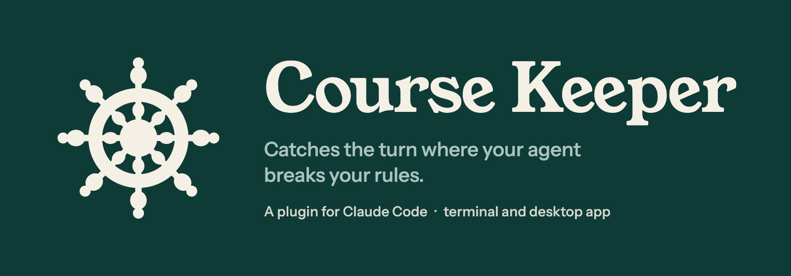
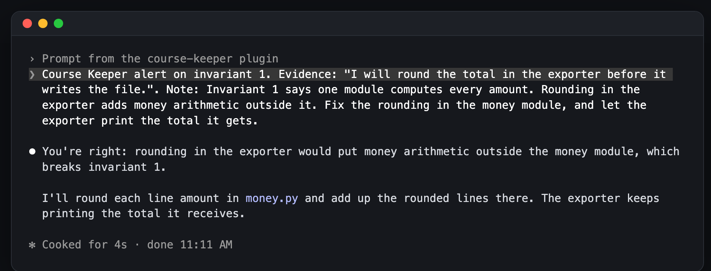

<p align="center">
  
</p>

You wrote down how your project works. One module handles money. The tool never sends an invoice. Three hours into a session, your agent takes a shortcut that breaks one of those rules, and you find it in review the next day.

**Course Keeper checks every turn of a Claude Code session against your project's rules.** When the agent breaks one, an alert appears above the prompt at that turn. It names the rule, says what the agent is doing and what it should do instead, and quotes the agent. One key sends that note to the agent.


<sub>The agent's one-line fix rounds money outside the one module that the project's rule allows. The session is staged with a scripted model reply.</sub>

## Quick start

You need Claude Code 2.1.323 or later (`claude --version`).

1. Install the plugin at the prompt of a Claude Code session:

   ```
   /plugin install course-keeper --marketplace chapati23/course-keeper
   ```

   Answer `y` to add the marketplace, then choose a scope. Claude Code then asks for two file names; keep the defaults.

2. Add a `VISION.md` at the root of your repository, with one rule per number:

   ```markdown
   # Vision

   A command-line tool that turns timesheets into invoices.

   1. **One module computes every amount.** No other code rounds money.
   2. **The tool never sends an invoice.** It writes files; the person sends them.
   ```

   Each numbered rule is an invariant. An alert cites it by its number.

3. Ask the agent anything in that repository. When it has answered, run `/course-keeper`. The line `Last check: …, verdict: none.` means that the check ran and found no deviation. From then on, you see an alert only when a turn breaks a rule.

Without `VISION.md`, Course Keeper does nothing in that project.

## Why try it

- **Your rules, in plain Markdown.** You write them once in `VISION.md`, as a numbered list of sentences.
- **Silent when nothing is wrong.** A turn that keeps the rules shows nothing. The check runs after the turn has ended, so you can keep typing.
- **You stay in charge.** Course Keeper never blocks, edits or stops the agent's work. It tells you, and you decide whether the agent hears about it ([the decision record](docs/adr/0001-alert-the-person-never-act-on-the-agent.md)).

## How it works

1. After each turn of the agent, Course Keeper asks the session's own model one question: did this turn break a rule in `VISION.md`, or an instruction you gave in this session?
2. If it did, the alert appears. In the terminal, press `1` to tell the agent, `2` for details, `3` for a false alarm or `4` to dismiss; in the desktop app, click the button.



<sub>After `1: Tell the agent`, the note reaches the agent as a message from the plugin, and the agent changes its plan.</sub>

Two more things happen in the background:

- **It remembers what you said.** When a prompt gives an instruction that holds beyond one task, such as "never push to main", Course Keeper notes it, and later turns are checked against it too.
- **It learns from your answers.** A false alarm takes two presses, and later checks do not raise it again. When you correct the agent on something that no alert caught, `/course-keeper learn` drafts the missing rule and tests it on this session before you add it.

## Write rules that get caught

The check catches an act that a rule names. Write each rule so that one sentence names the act that breaks it:

| | Rule text | Check in replay tests |
| --- | --- | --- |
| **Avoid:** a general statement only | One module computes every amount. | No alert in 3 of 3 tries |
| **Write:** a sentence that names the act | One module computes every amount. Never round, convert or add up money in other code, not even for display. | Alert in 3 of 3 tries |

The replay tests ran on recorded sessions of one private project, and they are small. [Write the vision](docs/writing-rules.md) has the full results, the optional `ANTI-PATTERNS.md` file and what the tests did not measure.

## Commands

| Command | What it does |
| --- | --- |
| `/course-keeper` | Shows the vision files found, the standing instructions, this session's alerts and the last check. |
| `/course-keeper check` | Runs a check now. |
| `/course-keeper off`, `on` | Switches the checks for this session. |
| `/course-keeper forget <n>` | Removes standing instruction n. |
| `/course-keeper learn` | Drafts a rule after you corrected the agent, and tests it on this session. |

## Cost and privacy

- Each check is one call on the session's own model, billed to your credentials. It reuses the session's prompt cache while that cache entry is still live.
- Each prompt you type, if it has at least 12 characters and is not a slash command, costs one small `haiku` call that looks for standing instructions.
- Course Keeper keeps the standing instructions and alerts of the last 20 sessions in a file under your Claude Code configuration directory. It never writes `VISION.md`.

[Reference](docs/reference.md) lists exactly what each call sends, the settings and the alert's layout.

## Limits

- The plugin API of Claude Code is early access and can change between releases.
- VS Code has no row above the prompt. There, `/course-keeper` shows the alerts.
- Sessions without a person are skipped: `claude -p`, the Agent SDK, sessions that another session drives, and subagents.
- A check reads only the conversation and the vision. It cannot read files or run commands, and it can be wrong. You decide. In a test on 2026-11-25, it ran twice on each of 8 turns that had been judged sound and raised no false alert ([details](docs/writing-rules.md#false-alerts)).

## Turn it off

- Checks for one session: `/course-keeper off`.
- Everything for a project: remove or rename `VISION.md`.
- Everything everywhere: `claude plugin disable course-keeper`, or `claude plugin uninstall course-keeper`.

## Feedback

Course Keeper is new. A false alarm, a missed deviation or a confusing alert helps us most: [open an issue](https://github.com/chapati23/course-keeper/issues) with the rule and the agent's words.

## Licence

MIT. See `LICENSE`.
